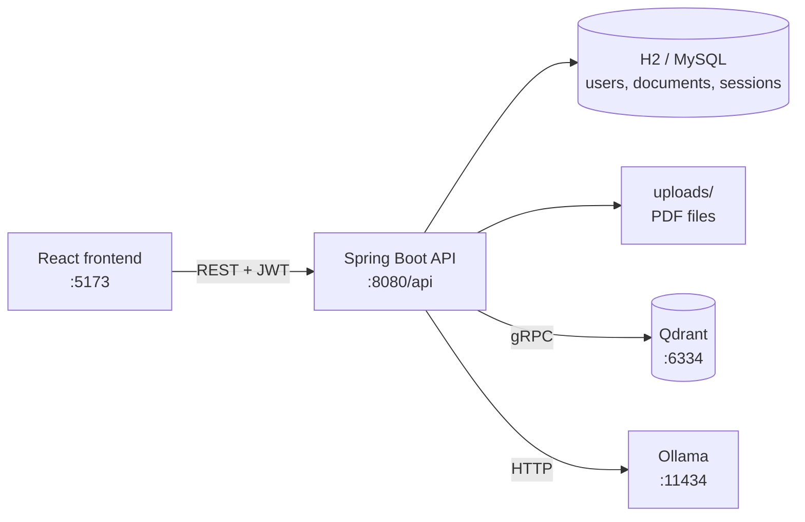

# AI Interview Preparation Assistant

A full-stack **Retrieval-Augmented Generation (RAG)** application for interview preparation. Users upload PDF study material and chat with an AI that answers **from their own documents, with page citations**. When a question is not covered by the PDF, the assistant falls back to general interview guidance.

All AI runs **locally** through [Ollama](https://ollama.com) — no paid API keys and no document data leaves the machine.

---

## Features

- **JWT authentication** — register, log in, stateless secured REST API
- **Private documents per user** — every database query and vector search is filtered by the logged-in user
- **PDF upload and indexing** — page-aware text extraction, structure-aware chunking with overlap, vector embeddings stored in Qdrant
- **Document Q&A (RAG)** — hybrid retrieval (vector similarity + keyword re-ranking), answers cite `[Source N, page P]`
- **Sources panel** — each answer lists the PDF passages and page numbers it was based on
- **Follow-up questions** — recent chat history is used to understand questions like "and in the post-independent era?"
- **Whole-document summaries** — map-reduce summarization over the entire PDF, not just the top search hits
- **Practice question generation** — 10 interview questions drawn from across a document
- **Hallucination guards** — relevance threshold, unsupported-name detection, and quoting the PDF directly when the model is unsure
- **General interview mode** — chat with the AI without any PDF

---

## Tech stack

| Layer | Technology |
|---|---|
| Frontend | React 19, Vite, React Router, Axios |
| Backend | Java 21, Spring Boot 3.5, Spring Security (JWT), Spring Data JPA / Hibernate, Lombok |
| AI framework | Spring AI 1.0 |
| LLM | Ollama — `llama3.2:1b` (default) or `llama3.2:3b` |
| Embeddings | Ollama — `nomic-embed-text` (768 dimensions) |
| Vector database | Qdrant (Docker) |
| Relational database | H2 (dev profile), MySQL (prod profile) |
| PDF parsing | Apache PDFBox |

---

## Architecture



### RAG pipeline

**Indexing** (`POST /api/rag/documents/{id}/index`)

1. Extract text page by page with PDFBox
2. Split into ~1000-character chunks with 150-character overlap; headings start new chunks
3. Embed each chunk with `nomic-embed-text` (using its `search_document:` task prefix)
4. Store vectors in Qdrant with `userId`, `documentId`, `pageNumber`, `chunkIndex` metadata

**Answering** (`POST /api/chat/ask`)

1. Vector search in Qdrant, filtered to the user's document (original question + keyword-only variant)
2. Re-rank by `0.7 × vector score + 0.3 × whole-word keyword overlap`
3. Relevance check — weak matches fall back to general AI
4. Prompt the LLM with numbered, page-labelled excerpts and strict grounding rules
5. Post-checks: "not enough information" handling and unsupported-name detection
6. Return the answer with its source passages

---

## Project structure

```
RAG/
├── pom.xml
├── src/main/java/com/aiinterview/assistant/
│   ├── config/        # Ollama, Qdrant, security, chunking and RAG settings
│   ├── controller/    # Auth, Upload, RAG, Chat, AI, Interview REST controllers
│   ├── dto/           # Request / response objects
│   ├── entity/        # JPA entities: User, Document, InterviewSession, ...
│   ├── exception/     # Custom exceptions + GlobalExceptionHandler
│   ├── repository/    # Spring Data JPA repositories
│   ├── security/      # JWT filter, token provider, auth handlers
│   └── service/       # RAG, vector store, chunking, PDF extraction, auth, ...
├── src/main/resources/
│   ├── application.yml        # shared config (models, chunking, RAG tuning)
│   ├── application-dev.yml    # H2 file database
│   └── application-prod.yml   # MySQL
└── frontend-react/
    └── src/
        ├── api/         # Axios client and API calls
        ├── components/  # chat, documents, layout
        ├── context/     # AuthContext
        ├── pages/       # Login, Register, Dashboard, Upload, Chat
        └── routes/
```

---

## Getting started

### Prerequisites

- **Java 21+**
- **Node.js 18+**
- **Docker** (for Qdrant)
- **Ollama**

### 1. Start Qdrant

```bash
docker run -d --name qdrant -p 6333:6333 -p 6334:6334 qdrant/qdrant
# later runs: docker start qdrant
```

### 2. Pull the Ollama models

```bash
ollama pull llama3.2:1b
ollama pull nomic-embed-text
# optional, more accurate but slower on CPU:
ollama pull llama3.2:3b
```

### 3. Run the backend

```bash
# Windows
mvnw.cmd spring-boot:run

# macOS / Linux
./mvnw spring-boot:run
```

The API starts at `http://localhost:8080/api` using the **dev** profile (H2 file database in `./data`).

### 4. Run the frontend

```bash
cd frontend-react
npm install
npm run dev
```

Open **http://localhost:5173**, register an account, upload a PDF, click **Index**, then ask questions in **Chat → My PDF (RAG)**.

---

## Configuration

Key settings live in `src/main/resources/application.yml`.

| Setting | Default | Purpose |
|---|---|---|
| `app.ai.chat-model` | `llama3.2:1b` | Chat model (override with `CHAT_MODEL`) |
| `app.ai.num-ctx` | `8192` | Ollama context window (tokens) |
| `app.chunking.chunk-size` / `chunk-overlap` | `1000` / `150` | Chunking (characters) |
| `app.qdrant.top-k` | `8` | Chunks kept after re-ranking |
| `app.qdrant.keyword-weight` | `0.3` | Keyword share of the hybrid re-rank score |
| `app.qdrant.min-relevance-score` | `0.58` | Below this best score the PDF is treated as not relevant |
| `app.rag.max-context-characters` | `5000` | Excerpt text sent to the LLM per question |
| `app.rag.fallback-to-general` | `true` | Use general AI when the PDF has no answer |

### Environment variables

| Variable | Used for |
|---|---|
| `SPRING_PROFILES_ACTIVE` | `dev` (default) or `prod` |
| `JWT_SECRET` | JWT signing key — **set a strong value in any real deployment** |
| `CHAT_MODEL` | Ollama chat model name |
| `QDRANT_HOST`, `QDRANT_PORT`, `QDRANT_COLLECTION` | Qdrant connection |
| `MYSQL_HOST`, `MYSQL_PORT`, `MYSQL_DATABASE`, `MYSQL_USER`, `MYSQL_PASSWORD` | MySQL (prod profile) |
| `UPLOAD_DIR` | Where uploaded PDFs are stored (default `./uploads`) |

> After changing chunking or embedding settings, **re-index** existing PDFs so their vectors match.

---

## API overview

All endpoints are under `/api` and require `Authorization: Bearer <token>` except register and login.

| Method | Endpoint | Description |
|---|---|---|
| POST | `/auth/register` | Create an account, returns a JWT |
| POST | `/auth/login` | Log in, returns a JWT |
| GET | `/auth/me` | Current user |
| POST | `/documents/upload` | Upload a PDF (multipart `file`) |
| GET | `/documents` | List your documents |
| GET | `/documents/{id}` | Document details |
| GET | `/documents/{id}/download` | Download the PDF |
| GET | `/documents/{id}/extract` | Extracted text |
| DELETE | `/documents/{id}` | Delete a document |
| POST | `/rag/documents/{id}/index` | Chunk, embed and store the PDF in Qdrant |
| POST | `/rag/search` | Raw vector search (debugging / tuning) |
| POST | `/rag/ask` | RAG answer with full source details |
| POST | `/rag/documents/{id}/questions` | Generate 10 practice questions |
| POST | `/chat/ask` | Chat endpoint used by the UI (RAG or general, with history) |
| POST | `/ai/chat` | Direct LLM chat |
| POST | `/interviews/sessions` | Start an interview session |
| GET | `/interviews/sessions` | List your sessions |
| POST | `/interviews/sessions/{id}/answers` | Submit an answer |
| POST | `/interviews/sessions/{id}/complete` | Complete a session |

---

## Security

- Passwords hashed with **BCrypt**; stateless **JWT** authentication
- Only `/auth/register` and `/auth/login` are public
- Per-user isolation: documents and sessions are looked up by owner, and Qdrant searches are filtered by `userId` — another user's resource returns **404**
- `GlobalExceptionHandler` returns consistent JSON errors (400 / 401 / 404 / 405) without exposing internal details

---

## Performance notes

Local LLMs on a CPU-only machine are slow: expect roughly 1–4 minutes per answer with `llama3.2:1b`, and longer with `llama3.2:3b`. Faster answers need a GPU or more free RAM; `llama3.2:3b` gives noticeably more faithful answers when hardware allows.

---

## Roadmap

- Unit and integration tests (JUnit 5, Mockito, Testcontainers)
- Database migrations with Flyway
- Streaming responses to the chat UI
- Docker Compose for one-command startup
- Frontend pages for mock interview sessions
- CI pipeline (GitHub Actions)
